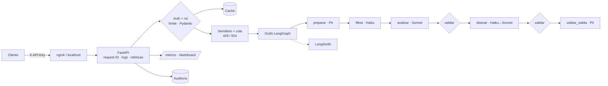

# feat: Sistema multi-agente en producción con observabilidad, optimización de costos y seguridad

## Resumen de cambios

La fábrica de agentes del Módulo 3 se expone como una **API REST de producción**: una cadena LangGraph
(guardrail → analista → diseñador de pruebas, con validadores deterministas entre agentes) convierte una historia
de usuario en criterios Gherkin y casos de prueba. Se agregan concurrencia controlada, contenedor endurecido con CI,
**trazas completas en LangSmith**, logs JSON con correlation ID y métricas de latencia, errores y costo; el costo bajó
**63 % frente al baseline** (100 % en repeticiones con caché) sin perder calidad, y la API aplica **13 controles de seguridad**.

## Arquitectura del sistema

### Diagrama



Diagramas completos y detallados en [`docs/arquitectura.md`](arquitectura.md).

### Flujo de comunicación entre componentes

1. El cliente llama `POST /v1/criterios` con `X-API-Key`. El middleware asigna el `X-Request-ID`, que viaja a logs,
   auditoría y LangSmith.
2. La capa de seguridad resuelve el rol de la llave, aplica el límite por llave y valida la historia.
3. Si la historia ya se procesó con la misma configuración, la caché responde de inmediato y sin costo.
4. Si no, la petición espera turno en un semáforo (cola acotada; si se llena, 429) y el grafo corre en un hilo,
   así la API sigue atendiendo otras peticiones.
5. En el grafo, la historia se enmascara (PII) antes de llegar a cualquier modelo; un guardrail en Haiku decide si
   continúa; el analista (Sonnet) escribe Gherkin y un validador determinista lo acepta o pide corrección; el
   diseñador (Haiku, con cascada a Sonnet) escribe los casos y otro validador revisa cobertura; la salida se revisa
   de nuevo por PII.
6. La respuesta trae criterios, casos, PII enmascarada y el costo por agente; la acción queda en la auditoría.

### Justificación de decisiones arquitectónicas

- **Producción = el análisis de la fábrica, no la construcción.** La construcción con Claude Code escribe en una
  carpeta compartida y tarda decenas de minutos; el análisis es entrada → salida, concurrente y cacheable.
- **Agentes sin herramientas.** En producción ningún agente toca archivos ni terminal (mínimo privilegio); el contexto
  se inyecta en el prompt, lo que además permite recortarlo y cachearlo.
- **Validadores deterministas entre agentes.** El código decide si una salida es válida; la reflexión está acotada.
- **Un proceso con semáforo y cola acotada.** Las llamadas al modelo son I/O; un proceso atiende varias sin duplicar
  memoria y degrada con 429/504 en lugar de saturarse. Para varias réplicas, el siguiente paso es Redis.
- **Ruteo de modelos con cascada.** Cada agente usa el modelo más barato capaz de su tarea y escala solo si falla.
- **Despliegue local + ngrok, imagen validada en CI.** El motor de Docker no corre en la máquina de desarrollo y el
  token personal no se sube a terceros; CI construye, prueba y publica la imagen en GHCR.

## Instalación y ejecución

El README y [`docs/despliegue.md`](despliegue.md) incluyen:

- **Requisitos previos:** Python 3.12+, cuenta de Claude (token `claude setup-token`), cuenta de LangSmith,
  Docker (opcional) y ngrok (para URL pública).
- **Clonar e instalar:** `git clone …`, `git checkout m4-produccion`, entorno virtual y
  `pip install -r produccion/requirements-dev.txt`.
- **Variables de entorno:** `cp .env.example .env` y llenar `CLAUDE_CODE_OAUTH_TOKEN`, `LANGSMITH_API_KEY`,
  `API_KEYS` (y opcionalmente `NGROK_AUTHTOKEN`, ruteo y límites).
- **Ejecución:** `python -m uvicorn produccion.api:app --port 8000` o `docker compose up -d --build`; pruebas con
  `python -m pytest produccion/tests`; benchmark con `python -m produccion.benchmark_costos`; demo con
  `python -m produccion.cliente_demo seguridad`.

## Video de demostración

Video de 4:44 con narración: [docs/video/demo_m4.mp4](video/demo_m4.mp4) — arquitectura, Swagger, petición real
a la cadena de agentes, caché, controles de seguridad contra la API real, trazas en LangSmith, panel y logs,
benchmark de costos y CI. Capturas comentadas en [docs/evidencia.md](evidencia.md).

## Notas adicionales

**Evidencia**
- Observabilidad: [`docs/observabilidad.md`](observabilidad.md) (traza real con tokens y costo por agente).
- Costos: [`docs/costos.md`](costos.md) y [`docs/costos/benchmark.json`](costos/benchmark.json).
- Seguridad: [`docs/seguridad.md`](seguridad.md) (13 controles, ejecución real, OWASP, checklist).
- CI: workflow `ci-produccion` en verde (pytest, bandit, pip-audit, gitleaks, build, contenedor endurecido, smoke test, GHCR).

**Limitaciones conocidas**
- Métricas, límite por llave y semáforo viven en memoria del proceso: varias réplicas necesitarían Redis.
- El costo es el precio de lista que reporta el Agent SDK; con la cuenta personal no se factura por token.
- Un timeout (504) no cancela el hilo del grafo en curso; termina en segundo plano.
- La detección de PII es por patrones (sin NER para nombres propios).

**Problemas encontrados y soluciones**
- El validador de gitleaks marcó como secreto la variable vacía `API_KEYS=` de `.env.example`: falso positivo
  ignorado por huella exacta en `.gitleaksignore`, sin desactivar la regla.
- El 422 de FastAPI reflejaba la entrada (posible eco de PII): se reemplazó por un manejador sin eco.
- El presupuesto por petición estaba declarado pero no se aplicaba: ahora corta los reintentos.

**Posibles mejoras**
- Redis para caché, límites y métricas compartidas; despliegue en Cloud Run / Container Apps con secretos en un gestor.
- Evaluaciones automáticas de calidad en LangSmith (datasets) como gate antes de cambiar prompts o modelos.

## Archivos en este PR

```
produccion/
  api.py              API FastAPI: endpoints, middleware, concurrencia, auditoría
  grafo.py            Grafo LangGraph de producción (agentes + validadores)
  llm.py              Puerta al modelo: salida estructurada, reintentos, tokens, costo, trazas
  contexto.py         Recorte del contexto por historia (optimización de prompt)
  cache.py            Caché SQLite de resultados
  pii.py              Detección y enmascarado de PII y secretos
  seguridad.py        API keys con roles, límite por llave, auditoría
  observabilidad.py   Logs JSON con correlation ID, métricas Prometheus
  config.py           Configuración 12-factor (sin secretos en código)
  dashboard.html      Panel de operación
  benchmark_costos.py Benchmark baseline vs optimizado
  cliente_demo.py     Cliente de demostración (criterios, seguridad, concurrencia)
  tests/              20 pruebas (LLM_FALSO, sin red)
docs/                 arquitectura, observabilidad, costos, seguridad, despliegue, video
Dockerfile · docker-compose.yml · .dockerignore · .github/workflows/ci.yml · .gitleaksignore
```

## Etiquetas

`Share-OK`

🤖 Generated with [Claude Code](https://claude.com/claude-code)
