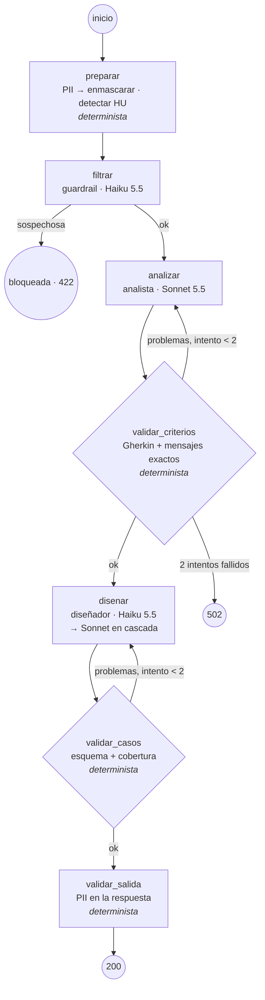

# Arquitectura · la fábrica de agentes en producción

## Vista general

```mermaid
flowchart LR
    C[Cliente / Swagger / cliente_demo] -->|HTTPS + X-API-Key| N[ngrok<br/>URL pública]
    N --> A
    subgraph Contenedor["Contenedor (usuario no root, FS de solo lectura)"]
      A[FastAPI · produccion/api.py<br/>middleware: X-Request-ID, logs JSON,<br/>métricas, encabezados de seguridad]
      A --> S{Seguridad<br/>API key + rol<br/>límite por llave<br/>validación Pydantic}
      S --> K[(Caché SQLite<br/>/datos)]
      S --> Q[Control de capacidad<br/>semáforo + cola acotada<br/>timeout 504]
      Q --> G[Grafo LangGraph<br/>produccion/grafo.py]
      A --> M[/metrics · /v1/metricas · /dashboard/]
      A --> AU[(auditoria_api.jsonl<br/>/datos)]
    end
    G -->|Claude Agent SDK<br/>tools=[]| L[Claude Haiku 5.5 / Sonnet 5.5]
    G -.->|trazas, tokens, costo| LS[LangSmith]
    GH[GitHub Actions] -->|pytest · bandit · pip-audit · gitleaks<br/>build + smoke test| R[(GHCR<br/>imagen)]
```

## La cadena multi-agente (grafo de producción)



Cada paso de un agente termina en una verificación determinista: **el código decide si se cumplió**, no el
modelo (la misma regla de la fábrica de M3). Los bucles de reflexión están acotados (`MAX_INTENTOS = 2`).

## Flujo de una petición

1. **Middleware**: asigna o respeta `X-Request-ID` (correlation ID), mide la latencia, agrega encabezados de
   seguridad, limita el cuerpo a 64 KB y nunca devuelve un stack trace.
2. **Seguridad**: `X-API-Key` → rol (`cliente`, `lector`) por hash sha256 en tiempo constante; permiso por rol;
   límite de 30 peticiones/minuto por llave; Pydantic valida la historia (tamaño, caracteres de control, forma de historia).
3. **Caché**: si la historia ya se procesó con la misma configuración, responde en ~10 ms y $0.
4. **Capacidad**: un semáforo deja correr `MAX_CONCURRENCIA` grafos a la vez; los demás esperan en una cola de
   tamaño `MAX_EN_COLA`; si la cola está llena responde **429 + Retry-After** (backpressure) y si un grafo excede
   `TIMEOUT_S` responde **504**. El grafo corre en un hilo del pool (`anyio.to_thread`), así el event loop sigue
   atendiendo `/health` y otras peticiones mientras los agentes trabajan.
5. **Grafo**: la traza de LangSmith lleva `request_id` en sus metadatos; cada llamada al modelo queda como run `llm:<agente>`
   con modelo, tokens y costo.
6. **Respuesta**: Gherkin, casos, preguntas abiertas, PII enmascarada y el desglose de costo por agente; la
   acción queda en la auditoría.

## Decisiones de arquitectura

| Decisión | Alternativa descartada | Por qué |
|---|---|---|
| Producción = la parte de **análisis** de la fábrica (criterios + casos), no la construcción con Claude Code | Exponer la fábrica completa (que edita `app/`) | La construcción escribe en una carpeta compartida y tarda decenas de minutos: no es concurrente ni idempotente. El análisis es puro (entrada → salida), escalable y cacheable. La fábrica completa sigue disponible por CLI (`flujos/flujo_s4.py`). |
| Agentes **sin herramientas** (`tools=[]`) y contexto inyectado en el prompt | Agentes con `leer_archivo`/`escribir_archivo` como en M3 | Mínimo privilegio: en producción ningún agente toca el sistema de archivos ni la terminal; además el prompt se puede recortar y cachear. |
| Claude Agent SDK con el token de la cuenta | SDK de Anthropic con API key | Decisión del reto (cuenta personal, sin API key); el SDK reporta tokens y costo de lista por llamada, suficiente para medir. |
| Un proceso con semáforo + cola acotada | Varios workers de Uvicorn o una cola externa (Redis/Celery) | Las llamadas al modelo son I/O: un proceso maneja varias a la vez sin duplicar memoria. Las métricas y el límite por llave viven en memoria, así que más réplicas necesitarían Redis (documentado como siguiente paso). |
| Caché SQLite en volumen | Redis | Cero servicios extra para un despliegue local o de un nodo; persiste entre reinicios. Para varias réplicas se cambia por Redis sin tocar la API. |
| Métricas propias en formato Prometheus | `prometheus_client` | Sin dependencias nuevas; el formato es compatible con Prometheus y Grafana. |
| ngrok para exposición pública + imagen validada en CI | Nube administrada (Render, Cloud Run) | El motor de Docker no corre en la máquina de desarrollo (Windows ARM sin WSL) y el token personal no se sube a terceros; CI demuestra que la imagen es reproducible y la publica en GHCR, lista para cualquier nube. |

## Resiliencia

- **Reintentos con validación**: si el modelo no cumple el esquema, se reintenta con el error (máx. `MAX_REINTENTOS_LLM`).
- **Cascada de modelos**: si el modelo barato falla el validador, el siguiente intento usa el de respaldo.
- **Degradación controlada**: 429 con `Retry-After` en vez de saturarse; 504 con mensaje claro; 502 si los agentes no
  logran una salida válida (nunca una respuesta a medias).
- **Health checks**: `/health` (liveness, lo usa Docker `HEALTHCHECK`) y `/ready` (readiness: credencial, volumen
  escribible, grafo compilado, llaves configuradas → 503 si falta algo).
- **Reinicio automático**: `restart: unless-stopped` en `docker-compose.yml`.

## Separación de entornos

| | Desarrollo / CI | Producción |
|---|---|---|
| Modelo | `LLM_FALSO=1` (respuestas deterministas, sin red ni credenciales) | Haiku 5.5 / Sonnet 5.5 con el token de la cuenta |
| Trazas | `LANGSMITH_TRACING=false` | Proyecto `m4-fabrica-produccion` en LangSmith |
| Secretos | llaves de prueba en el workflow | `.env` (no versionado) → variables de entorno del contenedor |
| Datos | carpeta temporal | volumen `/datos` |
