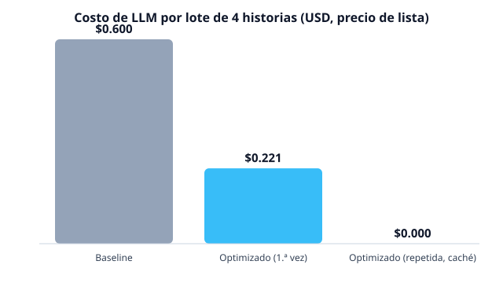

# Optimización de costos de LLM

**Resultado:** en el mismo lote de 4 historias (HU-01, HU-02, HU-03 y HU-10), el costo bajó de **$0.600 a $0.221
(−63.1 %)** la primera vez y a **$0.000** cuando la historia se repite (caché). Con un lote nuevo y uno repetido, el
ahorro combinado es de **−81.6 %**. La calidad, medida con los mismos validadores deterministas, se mantuvo:
**4/4 salidas válidas** en ambos modos.



Datos crudos: [`costos/benchmark.json`](costos/benchmark.json) · Script: `python -m produccion.benchmark_costos`
· Fecha de medición: 2026-11-18 · Costo = precio de lista que el Claude Agent SDK reporta en cada llamada
(`total_cost_usd`; con la cuenta personal es un equivalente: no se factura por token).

## Baseline y modo optimizado

| | Baseline | Optimizado |
|---|---|---|
| Guardrail (`filtrar`) | Sonnet 5.5 | **Haiku 5.5** |
| Analista | Sonnet 5.5 | Sonnet 5.5 (sin cambio: es donde está el razonamiento) |
| Diseñador de pruebas | Sonnet 5.5 | **Haiku 5.5**, con cascada a Sonnet si el validador lo rechaza |
| Contexto del analista y del diseñador | Los 2 archivos completos | **Solo las secciones que aplican a la HU** |
| Caché de resultados | No | **Sí** (SQLite, TTL 24 h, clave = historia + versión de prompts + modelos) |

## Resultados por historia

| Historia | Baseline | Optimizado | Ahorro | Repetida (caché) | Escenarios B → O | Casos B → O | Válida B / O |
|---|---|---|---|---|---|---|---|
| HU-01 | $0.1726 | $0.0670 | −61 % | $0.0000 | 12 → 12 | 35 → 25 | ✔ / ✔ |
| HU-02 | $0.1227 | $0.0333 | −73 % | $0.0000 | 12 → 11 | 24 → 22 | ✔ / ✔ |
| HU-03 | $0.1036 | $0.0355 | −66 % | $0.0000 | 14 → 13 | 23 → 19 | ✔ / ✔ |
| HU-10 | $0.2013 | $0.0856 | −57 % | $0.0000 | 28 → 32 | 31 → 35 | ✔ / ✔ |
| **Total** | **$0.6003** | **$0.2215** | **−63.1 %** | **$0.0000** | 66 → 68 | 113 → 101 | 4 / 4 |

## Dónde se fue el dinero (por agente)

| Modo | Agente | Modelo | Llamadas | Tokens entrada | Tokens salida | Costo |
|---|---|---|---|---|---|---|
| Baseline | filtro | Sonnet 5.5 | 4 | 7,069 | 563 | $0.0347 |
| Baseline | analista | Sonnet 5.5 | 4 | 28,425 | 13,206 | $0.1729 |
| Baseline | **diseñador** | Sonnet 5.5 | 4 | 37,569 | 31,437 | **$0.3927** |
| Optimizado | filtro | **Haiku 5.5** | 4 | 7,153 | 698 | **$0.0016** (−95 %) |
| Optimizado | analista | Sonnet 5.5 | 5 | 21,339 | 15,085 | $0.1944 |
| Optimizado | diseñador | **Haiku 5.5** | 4 | 25,682 | 42,146 | **$0.0255** (−94 %) |

Lectura: el baseline gastaba **dos terceras partes en el diseñador**, una tarea de transformación
(Gherkin → JSON) que no necesita el modelo más fuerte. Ahí está el mayor ahorro.

## Estrategias y sus trade-offs

### 1. Ruteo de modelos con cascada (la de mayor impacto)
- **Qué:** cada agente usa el modelo más barato capaz de su tarea. Clasificar (guardrail) y transformar
  (diseñador) van a Haiku; analizar reglas de negocio va a Sonnet. Si la salida de Haiku no pasa el validador
  determinista, el siguiente intento **escala a Sonnet** (`MODELO_RESPALDO`), así que solo se paga más cuando hace falta.
- **Ahorro medido:** filtro −95 % y diseñador −94 %.
- **Trade-off:** Haiku escribió **11 % menos casos** (101 contra 113), sobre todo menos casos e2e redundantes.
  La cobertura no bajó (cada escenario tiene al menos un caso, que el validador exige), pero hay menos
  redundancia. Si un equipo quiere el doble caso api + e2e en todos los escenarios, se puede agregar esa regla
  al validador: la cascada pasaría esos casos a Sonnet automáticamente.
- **Riesgo:** un guardrail en Haiku podría dejar pasar una inyección más sutil. Mitigación: los controles
  deterministas siguen detrás (agentes sin herramientas, validación de salida, PII), y la HU-99 se bloqueó
  igual con Haiku (`docs/seguridad.md`).

### 2. Optimización de prompt: contexto recortado
- **Qué:** `produccion/contexto.py` manda solo el bloque general más el bloque de la HU analizada, y quita las
  secciones que no le sirven a un analista (arquitectura, puertos, reglas para quien programa).
- **Ahorro medido:** el analista pasó de **7,106 a 4,268 tokens de entrada por llamada (−40 %)**; para HU-01 a HU-03
  el contexto ya no incluye las reglas de vacaciones.
- **Trade-off:** si una historia toca reglas de otra HU sin mencionarla, el analista no las ve. Lo mitiga el
  validador de mensajes exactos (falla si faltan los de la HU) y las preguntas abiertas.
- **Nota:** en HU-01 el analista optimizado necesitó un 2.º intento (reflexión con el validador). Por eso su
  línea muestra 5 llamadas: el reintento también se paga, y aun así el lote ahorró 63 %.

### 3. Caché de resultados
- **Qué:** la misma historia (normalizada: espacios y mayúsculas) con la misma configuración regresa la
  respuesta guardada: **$0 y ~10 ms** en lugar de ~60 a 100 s.
- **Ahorro medido:** 100 % en repeticiones (lote 3 del benchmark). En el panel se ve como «Ahorro por caché».
- **Trade-off:** respuestas idénticas para entradas idénticas (en este dominio es deseable) y datos guardados
  por 24 h. La clave incluye la versión de prompts y los modelos: cambiar un prompt invalida todo y nunca
  sirve una respuesta vieja. No se guardan secretos (la historia ya va sin PII).

### 4. Prompt caching del proveedor (automático)
El sistema estable (instrucciones + contexto) va **primero** en cada prompt y la historia al final, así el
prefijo se reutiliza entre peticiones de la misma HU (`cache_read_tokens` en cada respuesta y en LangSmith).

## Controles de gasto
- `PRESUPUESTO_PETICION_USD` y `MAX_REINTENTOS_LLM` acotan el gasto por petición; `MAX_INTENTOS` acota la reflexión.
- Cada respuesta de la API trae `costo_usd` y el desglose por agente; `/metrics` expone `fabrica_costo_usd_total{modelo}`
  y `fabrica_ahorro_cache_usd_total`; LangSmith suma el costo por traza y por proyecto.

## Cómo reproducir
```bash
python -m produccion.benchmark_costos            # 3 lotes: baseline, optimizado y optimizado repetido
```
Los modos se controlan con `RUTEO_ACTIVO`, `CONTEXTO_RECORTADO` y `CACHE_ACTIVO` (ver `.env.example`).
En LangSmith, filtra por la etiqueta `benchmark:baseline` o `benchmark:optimizado` para comparar las trazas.
