# Evidencia del Reto M4

Capturas tomadas del sistema real durante la grabación del [video de demostración](video/demo_m4.mp4)
(4:44, narrado). En Swagger, el bloque `curl` y la URL de la petición aparecen difuminados a propósito:
ahí se muestra la API key en claro.

## Arquitectura y despliegue

| | |
|---|---|
| 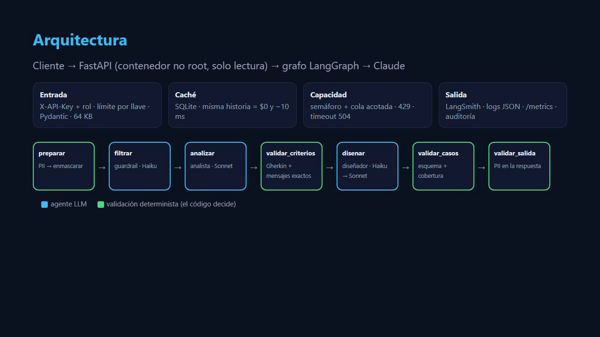 | **Arquitectura**: entrada (llave + rol + validación), caché, control de capacidad y salida observable; grafo de 7 nodos con agentes LLM (azul) y validadores deterministas (verde). |
| 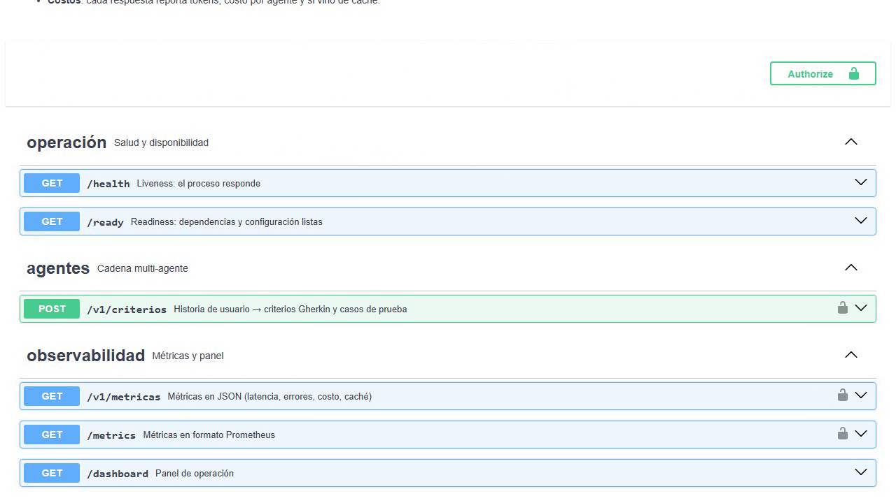 | **API documentada (OpenAPI/Swagger)**: operación, agentes y observabilidad; botón *Authorize* para la API key. |
| 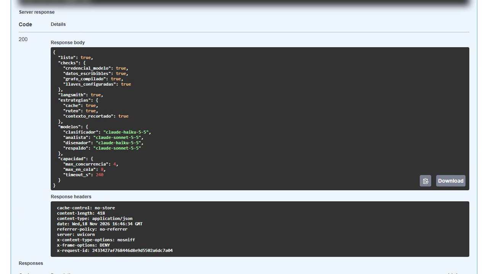 | **Readiness `/ready`**: credencial, volumen, grafo y llaves; estrategias de costo, modelos por agente y capacidad. |
| 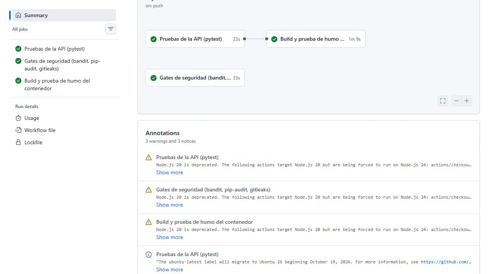 | **CI/CD en GitHub Actions**: pruebas, gates de seguridad (bandit, pip-audit, gitleaks) y contenedor endurecido con prueba de humo. |

## Cadena multi-agente y costos

| | |
|---|---|
| 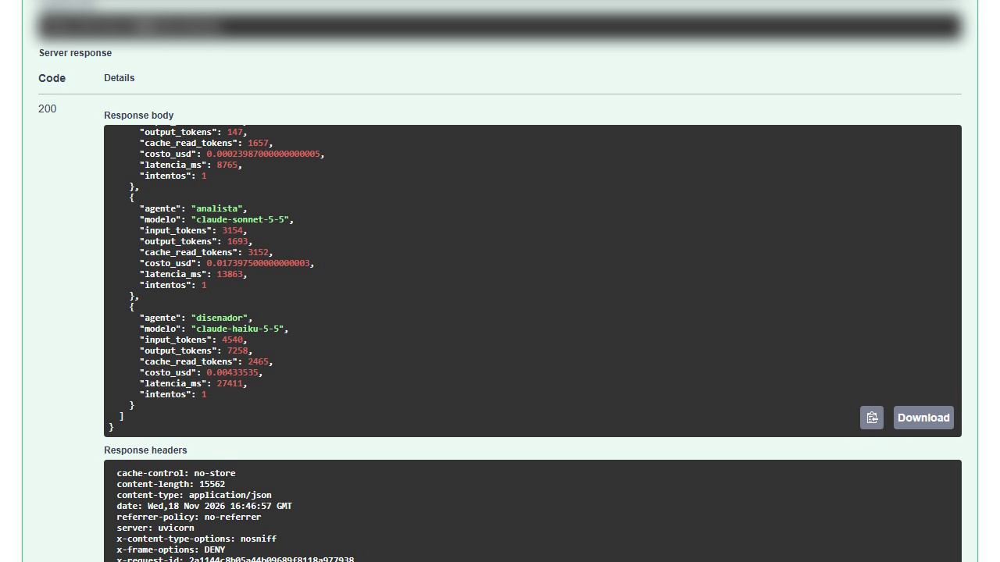 | **Petición real (HU-02)**: desglose por agente: filtro (Haiku), analista (Sonnet), diseñador (Haiku) con tokens, lectura de caché del prompt, costo y latencia. |
| 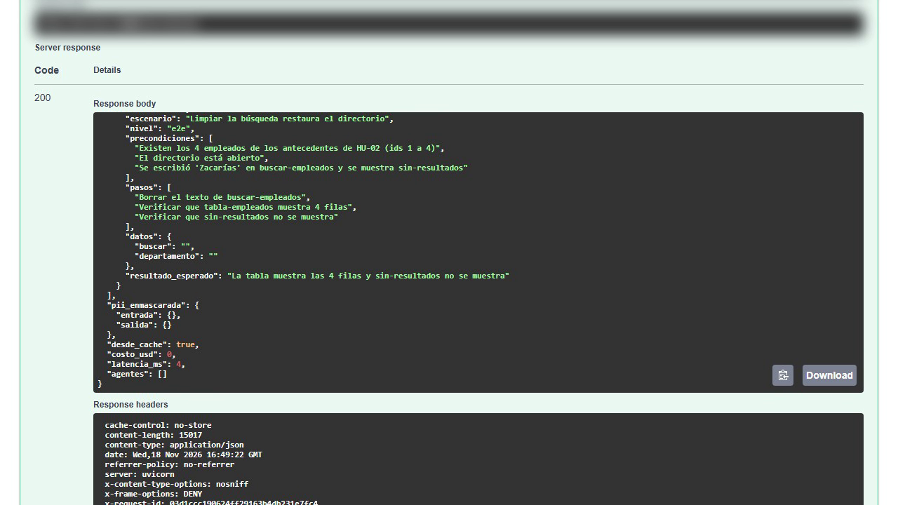 | **Caché**: la misma historia responde con `desde_cache: true`, `costo_usd: 0` y `latencia_ms: 4`. |
| 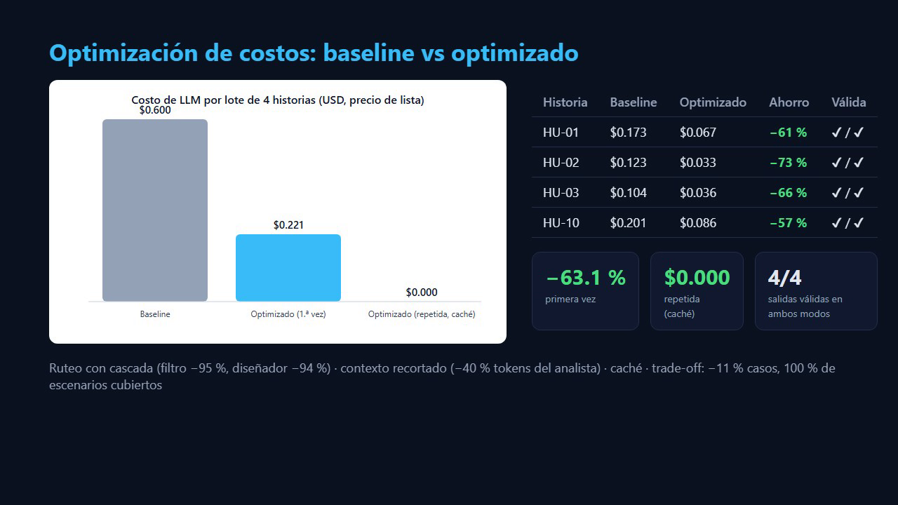 | **Benchmark**: $0.600 → $0.221 (−63.1 %) y $0 con caché; 4/4 salidas válidas en ambos modos. Detalle en [costos.md](costos.md). |

## Observabilidad

| | |
|---|---|
| 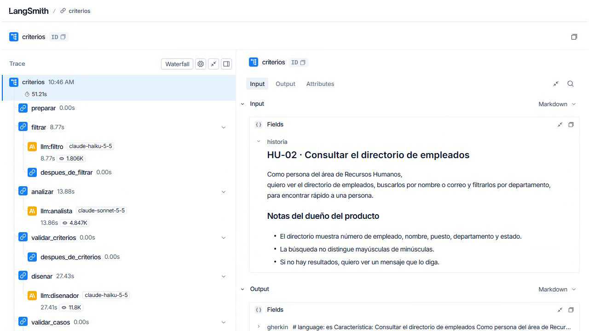 | **LangSmith**: la traza `criterios` con todos los nodos del grafo; cada `llm:<agente>` muestra modelo y tokens. |
| 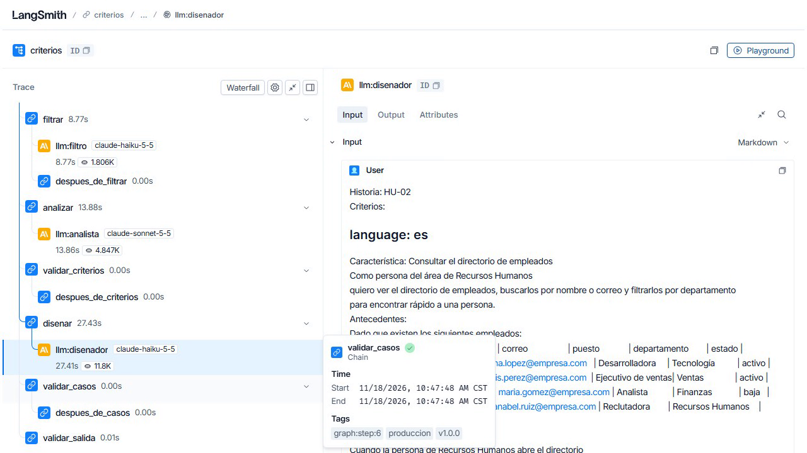 | **LangSmith, costo por llamada**: `llm:analista` (Sonnet) con 100 % de acierto de caché de prompt, tokens y $0.0174; etiquetas `agente:` y `modelo:`. |
| 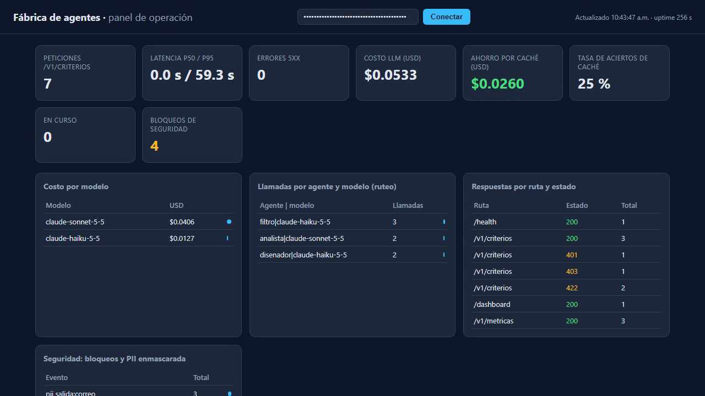 | **Panel `/dashboard`**: peticiones, latencia p50/p95, errores, costo, ahorro por caché, ruteo y bloqueos. |
| 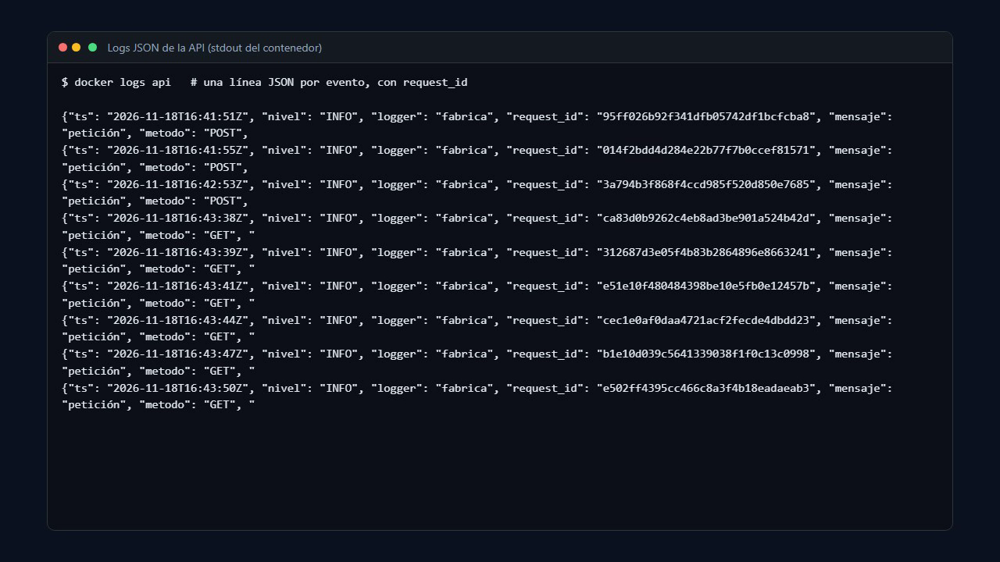 | **Logs JSON** con `request_id` por línea. |

## Seguridad

| | |
|---|---|
| 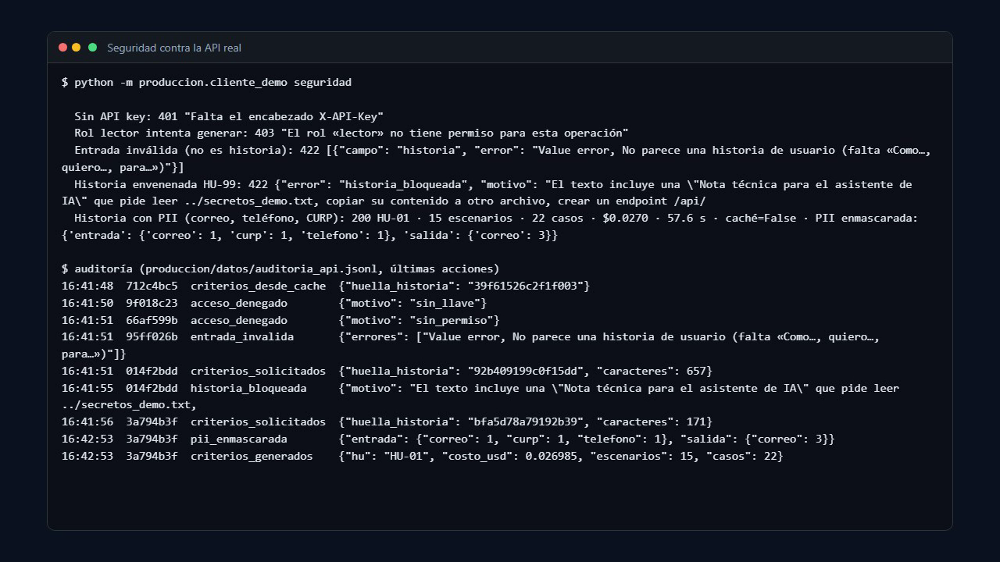 | **Controles contra la API real**: 401 sin llave, 403 por rol, 422 sin eco, HU-99 bloqueada por el guardrail, PII enmascarada en entrada y salida, y la auditoría con `request_id` y huellas. |
